# Lab Members

---

<figure>

	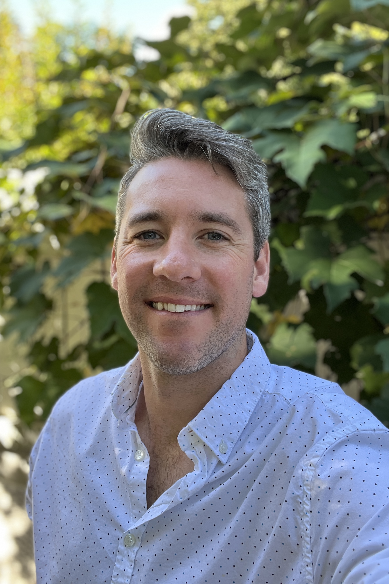

</figure>

**[Alex Marand](https://scholar.google.com/citations?hl=en&user=_bYW4UkAAAAJ)**

amarand@umich.edu

**Position:**\
Assistant Professor and Principal Investigator

**About Me:**\
NIH K99 and NSF Postdoctoral Fellow, University of Georgia\
Ph.D. University of Wisconsin\
B.Sc. Virginia Polytechnic Institute and State University
 
 

---

## Postdoctoral Scholars

<figure>

	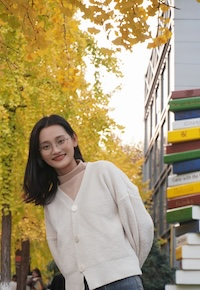

</figure>

**[Shuting Ding](https://scholar.google.com/citations?hl=en&user=SIEl_I8AAAAJ)**

shutingd@umich.edu

**Position:**\
Schmidt AI in Science Postdoctoral Fellow\
Co-mentored by [Dr. Minji Kim](https://www.minjilab.com)

**About Me:**\
Ph.D. Zhejiang University\
B.Sc. Zhejiang University
 

---

<figure>

	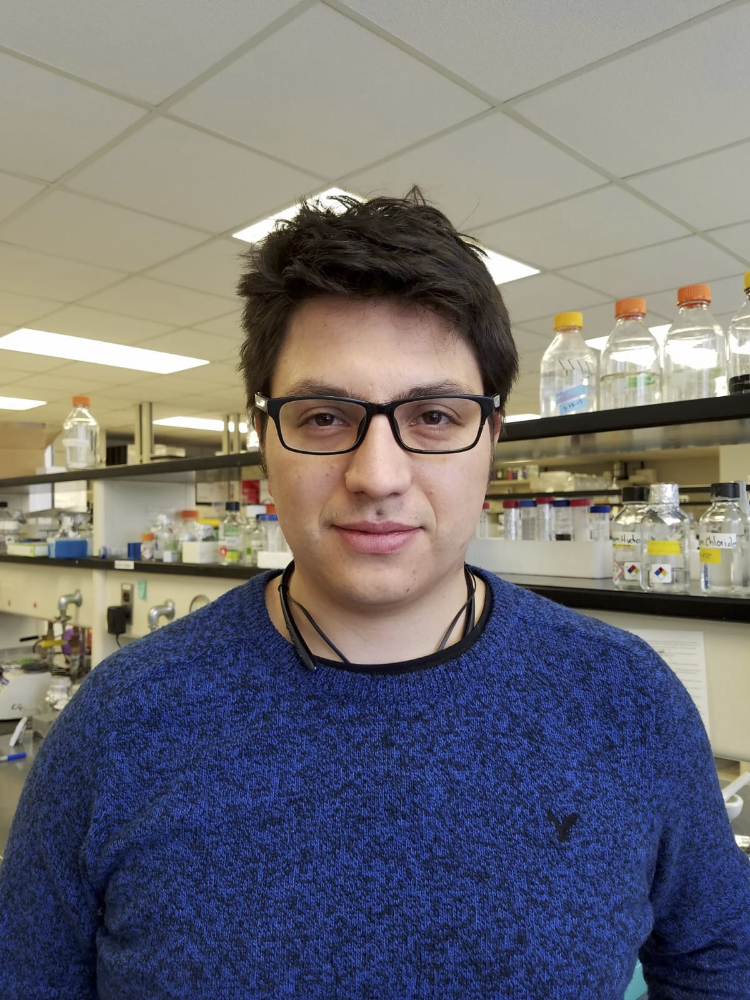

</figure>

**[Fabio Gomez-Cano](https://scholar.google.com/citations?user=iQ5p-UYAAAAJ&hl=en&oi=ao)**

gomezcan@umich.edu

**Position:**\
Pioneer Postdoctoral Fellow

**About Me:**\
Ph.D. Michigan State University\
M.Sc. Universidad de los Andes\
B.Sc. Universidad Nacional de Colombia

---

<figure>

	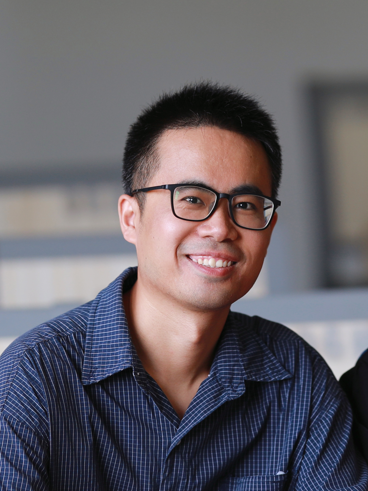

</figure>

**Luguang Jiang**

lgjiang@umich.edu

**Position:**\
Postdoctoral Scholar

**About Me:**\
Ph.D. China Agricultural University\
B.Sc. Heilongjiang University\
 

---
## Graduate Students

<figure>

	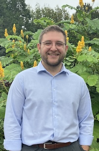

</figure>

**James Loveland**

jamespl@umich.edu

**Position:**\
Ph.D. Candidate

**About Me:**\
B.A. Kenyon College\
 
 
 

---

<figure>

	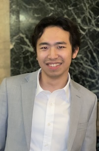

</figure>

**Andrew Luo**

jcluo@umich.edu

**Position:**\
Ph.D. Candidate

**About Me:**\
B.A. Vassar College\
 
 
 

---

<figure>

	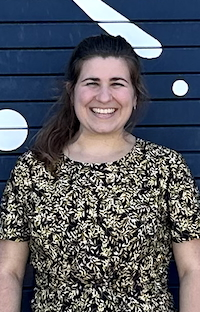

</figure>

**Rachel Rivero**

rrivero@umich.edu

**Position:**\
NASA Space Technology Graduate Researcher

**About Me:**\
B.Sc. Texas State University\
 
 
 

---

<figure>

	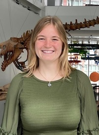

</figure>

**[Holly Scheer](https://scholar.google.com/citations?user=Jjubl3EAAAAJ&hl=en)**

scheerh@umich.edu

**Position:**\
Ph.D. Candidate

**About Me:**\
B.Sc. University of Michigan\
 
 

---

<figure>

	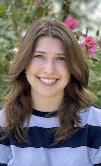

</figure>

**Lane Vitek**

lvitek@umich.edu

**Position:**\
PhD Candidate - NIH T32 Genetics Training Program Fellow

**About Me:**\
B.Sc. Michigan State University\
 
 
 

---

## Staff

<figure>

	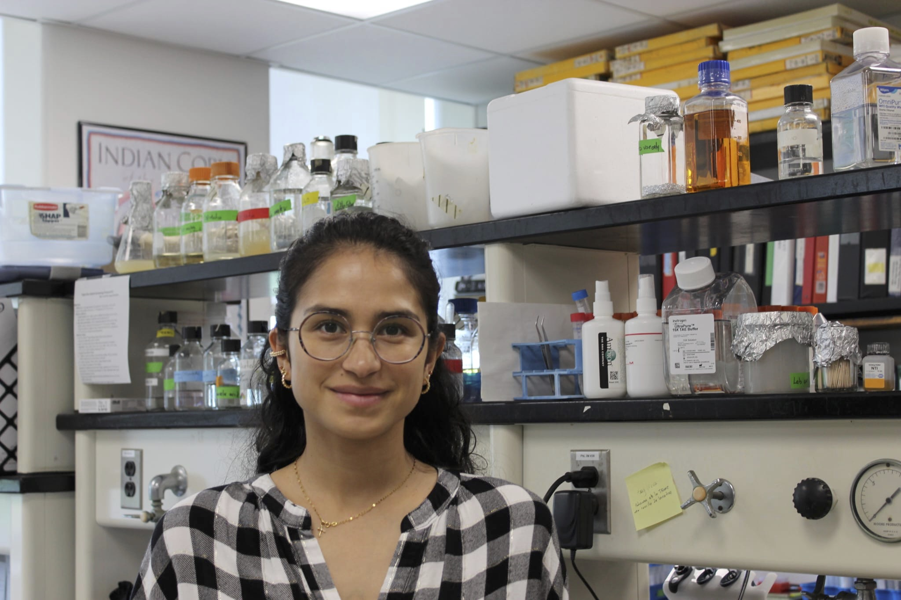

</figure>

**[Mariel Cruz-Gomez](https://scholar.google.com/citations?hl=en&user=yO8JCWgAAAAJ)**

cruzgome@umich.edu

**Position:**\
Research Lab Specialist

**About Me:**\
B.Sc. Universidad Pedagogica y Tecnologica de Colombia\
 
 
 

---

## Undergraduate Researchers

<figure>

	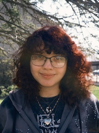

</figure>

**Kian Lawlor**

**Position:**\
Undergraduate Researcher

**About Me:**\
MCDB (Major) and Statistics (Minor), University of Michigan\
 
 
 

---

<figure>

	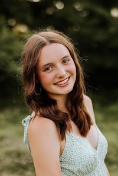

</figure>

**Skyler MacLachlan**

**Position:**\
Undergraduate Researcher

**About Me:**\
Biology Major, University of Michigan\
 
 
 

---

<figure>

	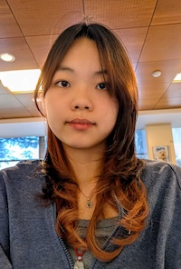

</figure>

**Emily Xu**

**Position:**\
Undergraduate Researcher

**About Me:**\
MCDB and Mathematical Biology Double Major, University of Michigan\
 
 
 
 

---

## Lab Alumni

---

#### Former Masters Students
**Evelyn Sowers** (2023-2026), PhD Student, University of Michigan, MCDB

#### Former Research Lab Specialists and Technicians
**Andrej Arsovski** (2024-2025), Professional Faculty, Washtenaw Community College\
**Maximo Clark** (2023-2025), PhD Student, University of California, Riverside\
**Kook Hui Ryu** (2024-2025)

#### Former Undergraduate Researchers
**Lara Kok** (2024-2026), Masters student in Human Genetics, University of Michigan\
**Lainey Weissman** (2025-2026)\
**Olivia Belau** (2024-2025)\
**Jasmine Crump** (2023-2025)
